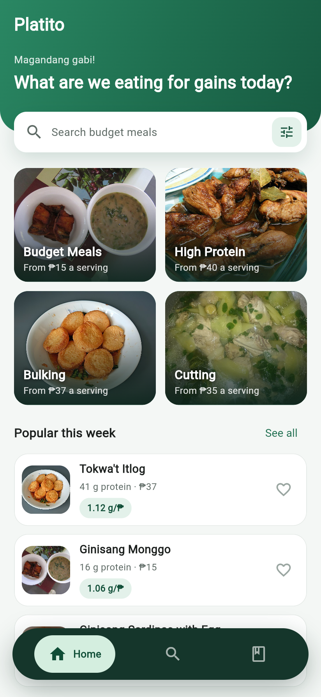
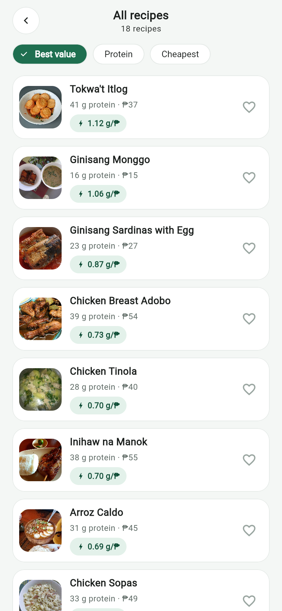
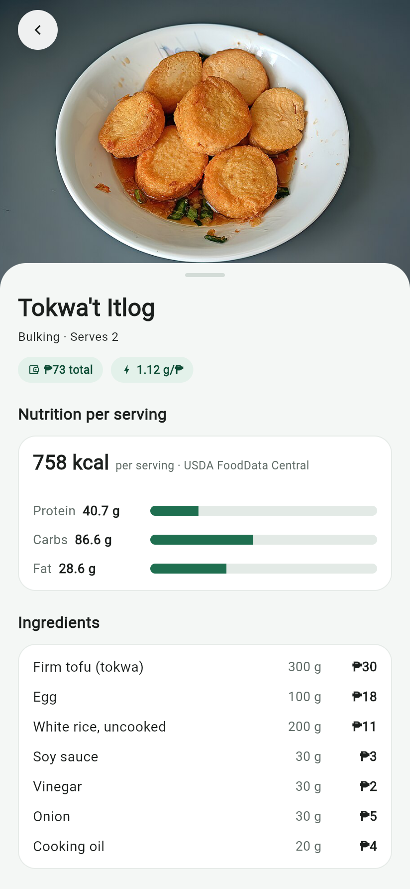
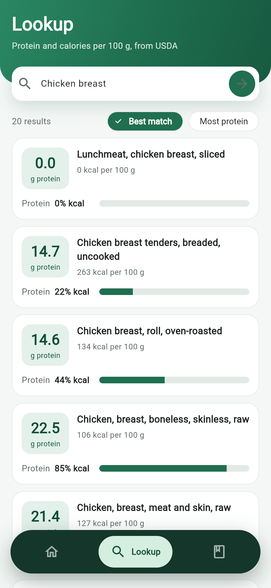
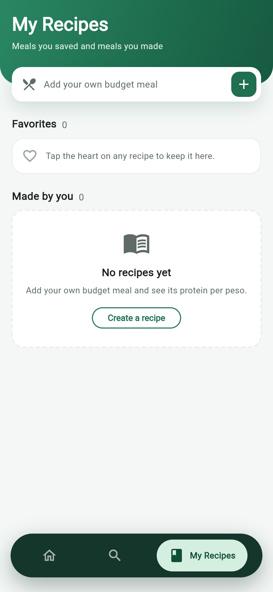
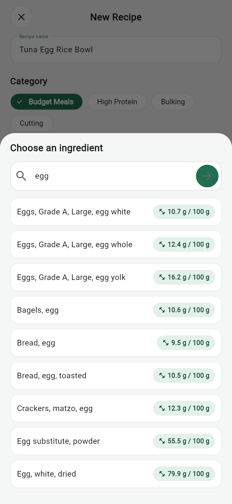

# Platito

Platito is a Flutter app for Android with simple, budget-friendly Filipino gym
meal recipes. Each recipe shows its estimated cost, its nutrition from the
USDA FoodData Central API, and its **protein per peso**: how many grams of
protein you get for every peso you spend. Students and gym-goers on a tight
budget can use it to find meals that give the most protein for the least
money, look up the protein in common ingredients, and save their own recipes.

## The protein-per-peso idea

```
protein per peso (g/₱) = protein per serving (g) ÷ cost per serving (₱)
```

For example, Ginisang Monggo costs ₱61 for 4 servings (₱15.25 each) and has
16.1 g of protein per serving, so it scores **1.06 g/₱**. A higher score means
more protein for your money. The "Best value" sort in the recipe list ranks
meals by this number.

Protein comes from USDA FoodData Central (values per 100 g, scaled to the
grams in the recipe). Prices are estimates in Philippine pesos stored with
each recipe.

## Screenshots

| Home | All recipes | Recipe detail |
|:---:|:---:|:---:|
|  |  |  |

| Lookup | My Recipes | New recipe |
|:---:|:---:|:---:|
|  |  |  |

| App icon | Splash screen |
|:---:|:---:|
|  |  |

## Features

- **Home:** four categories (Budget Meals, High Protein, Bulking, Cutting),
  each showing its cheapest price per serving, plus a "Popular this week" list
  and a "See all" link.
- **Recipe list:** 18 built-in recipes, filtered by category, with three sorts:
  Best value (protein per peso), Protein, and Cheapest.
- **Recipe detail:** photo, total cost, protein per peso, calories, protein,
  carbs, and fat per serving, the ingredient list with grams and prices, and
  numbered steps.
- **Ingredient Lookup:** search USDA FoodData Central for any ingredient and
  see its protein and calories per 100 g. Results can be sorted by best match
  or most protein. A shortcut list shows common gym ingredients ranked by
  protein.
- **My Recipes:** create, edit, and delete your own recipes. Ingredients are
  picked from a USDA search, so your recipe gets real nutrition and its own
  protein per peso. Your recipes also appear in their category's list.
- **Favorites:** tap the heart on any recipe to save it. Favorites and your
  own recipes are stored on the phone and are still there after the app
  restarts.
- **Offline handling:** if USDA can't be reached, the app shows "Can't reach
  USDA. Check your connection." with a Retry button.
- **App icon and splash screen** in the Platito green.

## Tech

- **Flutter** (Dart) for the Android app
- **Provider** for state management (`RecipeProvider` holds recipes,
  nutrition, and favorites)
- **USDA FoodData Central API** for nutrition data
- **shared_preferences** to save favorites and user recipes on the device

## Packages

Versions from `pubspec.yaml`:

| Package | Version | Used for |
|---|---|---|
| `provider` | ^6.1.5+1 | State management |
| `http` | ^1.6.0 | Calling the USDA API |
| `shared_preferences` | ^2.5.6 | Saving favorites and user recipes |
| `cupertino_icons` | ^1.0.8 | Default Flutter icon font |
| `flutter_launcher_icons` (dev) | ^0.14.4 | Generating the Android app icon |
| `flutter_native_splash` (dev) | ^2.4.8 | Generating the splash screen |
| `flutter_lints` (dev) | ^6.0.0 | Lint rules for `flutter analyze` |

## Setup and run

You need the Flutter SDK, Android Studio (Android SDK and an emulator), and a
free USDA API key from <https://fdc.nal.usda.gov/api-key-signup>.

1. Clone the repository and get the packages:
   ```bash
   git clone https://github.com/Jasehhh/Platito.git
   cd Platito
   flutter pub get
   ```
2. Create `keys.json` from the example file and put your USDA key in it:
   ```bash
   cp keys.example.json keys.json
   ```
   ```json
   { "USDA_API_KEY": "YOUR_KEY" }
   ```
   `keys.json` is listed in `.gitignore`, so the key is never committed.
3. Start an Android emulator (or connect a phone) and run:
   ```bash
   flutter run --dart-define-from-file=keys.json
   ```

The app reads the key with `String.fromEnvironment('USDA_API_KEY')`. If you
run it without `--dart-define-from-file=keys.json`, USDA requests fail with
"Missing USDA API key".

## Project structure

```
lib/
  main.dart     App entry point: MaterialApp, routes, and providers
  models/       Data classes: Recipe, RecipeIngredient, Food, Nutrient
  providers/    RecipeProvider: recipes, nutrition, favorites, sorting
  services/     UsdaService (USDA API calls) and StorageService (shared_preferences)
  screens/      Full screens: home, recipe list, recipe detail, recipe form,
                ingredient lookup, My Recipes, and the main shell with the dock
  widgets/      Reusable UI pieces: recipe cards, headers, badges, buttons,
                the ingredient search sheet, and the bottom dock
  theme/        AppColors and AppTheme (the Platito color scheme)
  utils/        Route names, peso and protein formatters, and NutritionCalculator
assets/
  recipes.json        The 18 built-in recipes
  images/recipes/     Recipe photos
  icon/               App icon source images
docs/                 Debugging case, release build notes, photo credits, screenshots
```

## Debugging case

During testing, the Lookup screen showed a connection error even though the
laptop seemed to be online. Logging the real exception showed that the message
was correct at that moment, but the investigation found a real bug: the main
Android manifest was missing the `INTERNET` permission, so a release APK would
have failed every USDA request. The permission was added and each kind of
failure now has its own message. Full write-up:
[docs/debugging-case.md](docs/debugging-case.md).

## Release build

How the debug and release APKs are built, where they are saved, their measured
sizes, and how they differ: [docs/release-build.md](docs/release-build.md).

## Photo credits

The recipe photos come from Wikimedia Commons. Authors and licenses are listed
in [docs/photo-credits.md](docs/photo-credits.md).

## Member

- **Justin Jan Dalumpines** – solo developer (all roles)

SE2142 – Software Engineering Tools and Practices, Final Project

## Repository

<https://github.com/Jasehhh/Platito>
