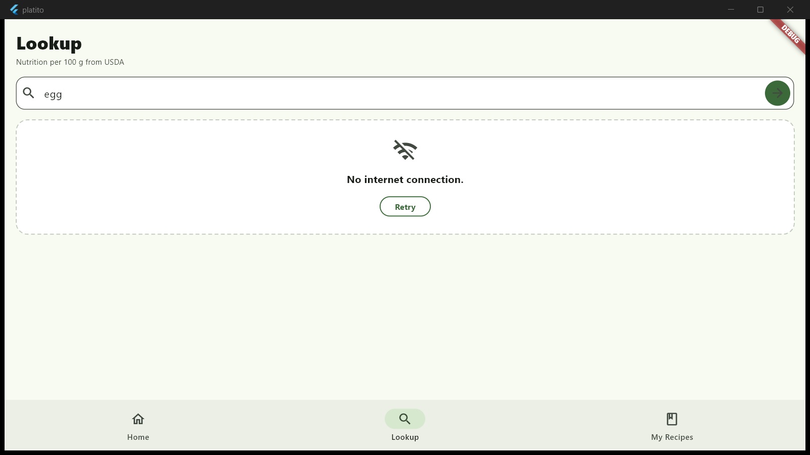
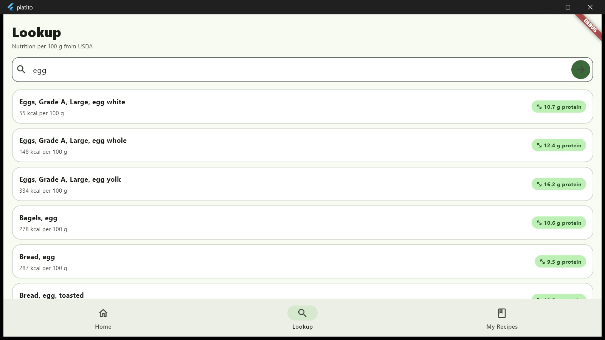

# Debugging case: "No internet connection" in ingredient search

Issue #4 · branch `feature/usda-api-service` · fix in commit `76f7aff`

## The bug

While testing the Ingredient Lookup screen, a search showed
**"No internet connection."** even though the laptop seemed to be online.
The question was whether the message was true, or whether some other error
was being shown with the wrong label.

*Error state. For this screenshot the offline case was simulated by pointing
the service at an unreachable host, which raises the same `ClientException`
(failed host lookup) as turning Wi-Fi off.*

## How we found the cause

1. **Logged the real exception.** In `UsdaService.searchFoods`, each `catch`
   block was given a temporary `debugPrint` that printed the exception's type,
   its message with the API key replaced by `<key>`, and the first lines of the
   stack trace. The full URL was never printed, because it contains the key.
2. **Reproduced the search** on Windows with
   `flutter run -d windows --dart-define-from-file=keys.json`.
3. **Ruled out the likely causes one by one:**

   | Possible cause | Result |
   |---|---|
   | The app runs on web and the browser blocks the request (CORS) | No. It ran on Windows, and USDA sends `Access-Control-Allow-Origin: *` anyway. |
   | The app was started without `keys.json` | No. A missing key shows "Missing USDA API key", not "No internet". |
   | The screen turns every error into "No internet" | No. The screen shows the message from `UsdaException`, and the service only uses "No internet connection." for `http.ClientException`. |
   | Android is missing the INTERNET permission | **Yes, a real bug.** `android/app/src/main/AndroidManifest.xml` did not declare it. Only the debug manifest did. |

4. **Result on Windows:** with Wi-Fi back on, the log showed no exceptions at
   all, and searches worked. The message seen during testing was correct, because
   Wi-Fi really was off at that moment.

## The fix

- **Android permission.** Added
  `<uses-permission android:name="android.permission.INTERNET"/>` to the main
  manifest. Flutter only puts this line in the *debug* manifest, so debug runs
  on a phone work, but a **release APK** would block every request and show
  "No internet connection" even with good Wi-Fi.
- **Clearer messages.** Each kind of failure now has its own text:
  - `http.ClientException` (offline, DNS or socket failure): "No internet connection."
  - `TimeoutException`: "The request timed out. Please try again."
  - Anything else: "Something went wrong. Please try again."
- Removed the temporary `debugPrint` lines.

## What I learned

- Log the **original exception type and stack trace** before guessing. A
  friendly error message can hide what really happened.
- Never log a full request URL when the API key is a query parameter.
- Test a **release build** on Android before submitting. Some problems, like
  missing permissions, only show up there.
